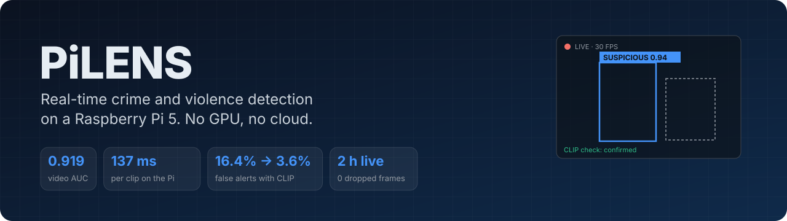
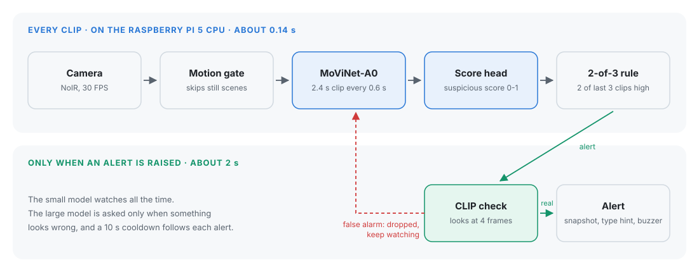
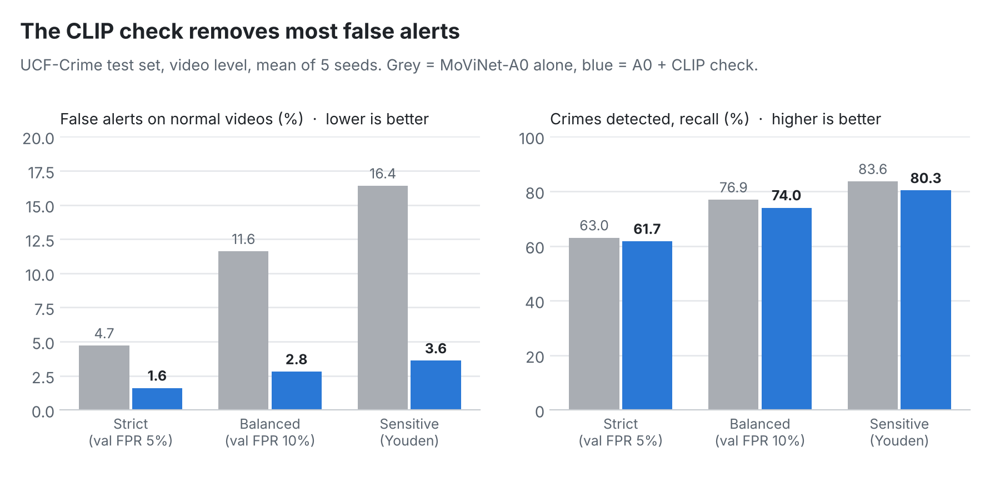
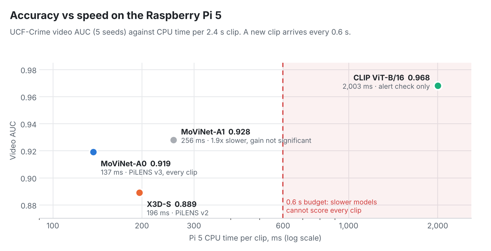
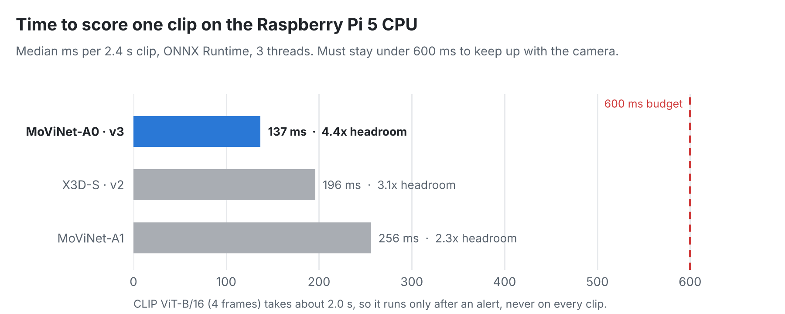
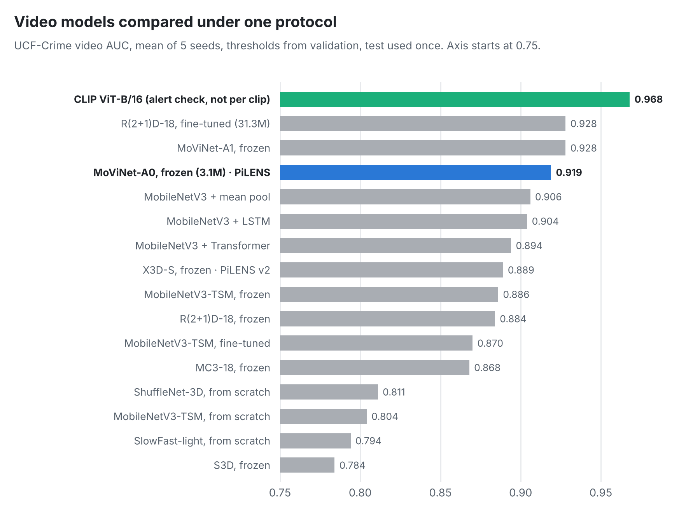
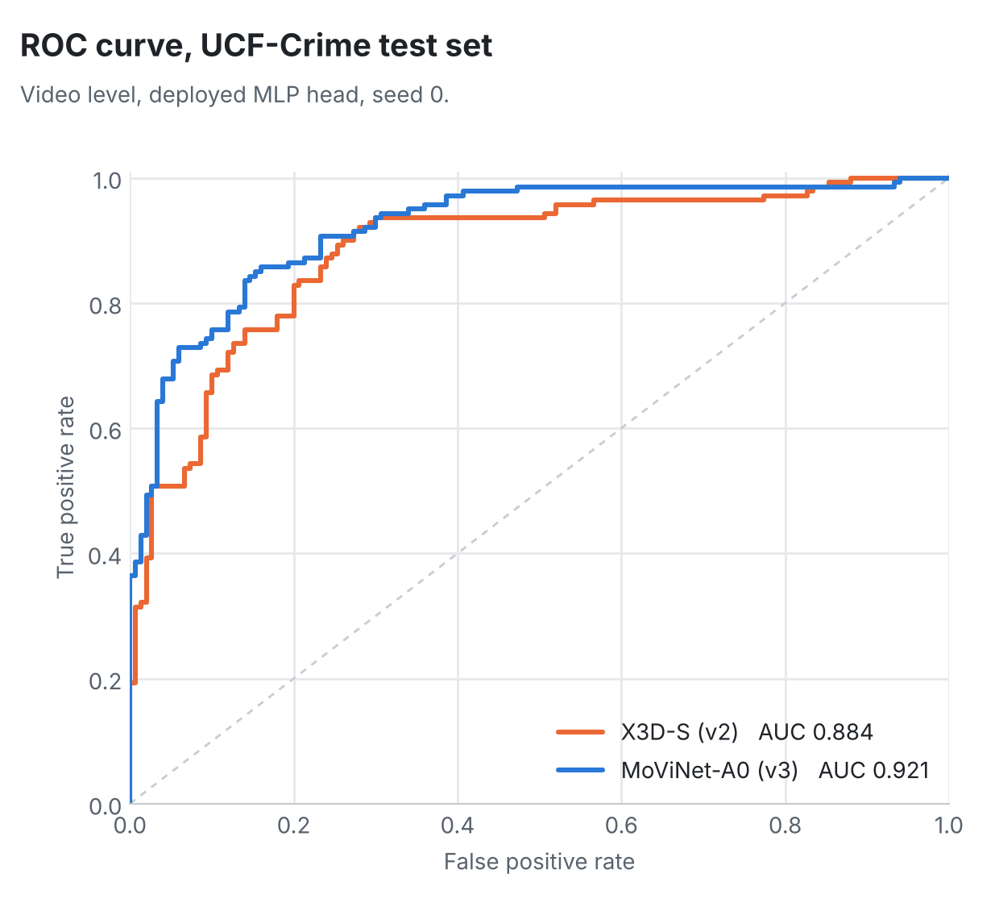
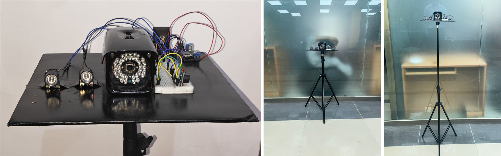

<p align="center">
  
</p>

<p align="center">
  <a href="CHANGELOG.md"></a>
  <a href="LICENSE"></a>
  
  
  
  
</p>

<p align="center">
  <a href="#overview">Overview</a> ·
  <a href="#how-it-works">How it works</a> ·
  <a href="#results">Results</a> ·
  <a href="#quick-start">Quick start</a> ·
  <a href="#hardware">Hardware</a> ·
  <a href="#versions">Versions</a> ·
  <a href="#roadmap">Roadmap</a>
</p>

## Overview

CCTV cameras are everywhere, but almost nobody watches them live, so a theft or a fight is usually found only later in the recording. Accurate AI video analysis normally needs a GPU server or a cloud subscription, which is costly, sends private video off the premises and stops when the internet does.

**PiLENS** is a small AI unit that watches a camera by itself and raises an alert the moment it sees crime or violence, such as theft, robbery, fighting or vandalism. The whole pipeline runs on the CPU of a **Raspberry Pi 5**, with no GPU and no cloud, and the video never leaves the device.

**What makes it different**

- **Two-step check.** A small video model (MoViNet-A0, 3.1M parameters) scores every 2.4-second clip in about 0.14 s. Only when it raises an alert does a much stronger vision-language model (CLIP ViT-B/16) look again. On the test set this removed most false alerts while keeping most real ones.
- **Built for the edge.** Every speed, temperature and stability number below was measured on the Pi itself, including a 2-hour live run.
- **Honest evaluation.** Thresholds are chosen on validation data, each test set is used once, and 16 video models were compared under the same protocol. The score files behind every number are in [`v3/results/`](v3/results/), and one command rebuilds the tables.

## How it works

<picture>
  <source media="(prefers-color-scheme: dark)" srcset="docs/figures/pipeline_dark.svg">
  
</picture>

| Step | What happens |
|---|---|
| 1. Motion gate | Clips in which nothing moves are skipped, which saves power. |
| 2. MoViNet-A0 | Turns each 13-frame clip (about 2.4 s) into a feature. A new clip is scored every 0.6 s. |
| 3. Score head | A small head trained with weak labels (multiple-instance learning) gives a suspicious score. |
| 4. 2-of-3 rule | An alert needs 2 of the last 3 clips above the threshold, followed by a 10 s cooldown. |
| 5. CLIP check | Only on an alert: CLIP looks at 4 frames of that clip and confirms or rejects it. |
| 6. Alert | Snapshot, crime-group hint (violence, theft, fire or damage, road accident), LED and buzzer. |

## Results

All numbers come from files in [`v3/results/`](v3/results/). UCF-Crime has 1,900 real surveillance videos with 13 crime types; XD-Violence was used as a second dataset.

### The CLIP check removes most false alerts

<picture>
  <source media="(prefers-color-scheme: dark)" srcset="docs/figures/clip_check_dark.png">
  
</picture>

### Accurate enough, and fast enough for the Pi

<picture>
  <source media="(prefers-color-scheme: dark)" srcset="docs/figures/accuracy_vs_speed_dark.png">
  
</picture>

<picture>
  <source media="(prefers-color-scheme: dark)" srcset="docs/figures/pi_latency_dark.png">
  
</picture>

<details>
<summary><b>More figures: all 16 models compared, ROC curve</b></summary>
<br>

<picture>
  <source media="(prefers-color-scheme: dark)" srcset="docs/figures/backbones_dark.png">
  
</picture>

<p align="center">
<picture>
  <source media="(prefers-color-scheme: dark)" srcset="docs/figures/roc_dark.png">
  
</picture>
</p>

</details>

### Summary

| What | Result |
|---|---|
| UCF-Crime video AUC (5 seeds) | **0.919 ± 0.003** (X3D-S in v2: 0.889 ± 0.004) |
| UCF-Crime frame AUC | 0.828 |
| XD-Violence video AUC (753-video single-label test subset) | 0.980 |
| False alerts on normal test videos, with the CLIP check | **16.4% → 3.6%** (recall 83.6% → 80.3%) |
| Pi 5 time per clip, MoViNet-A0, 3 threads | **137 ms** (budget 600 ms); 10-minute soak flat at 65–67 °C, no throttling |
| Pi 5 live run, 2 hours, normal room, CLIP loaded | 216,036 frames at 30 FPS, **0 dropped**, max 63.9 °C; 0 alerts at the deployed threshold (95% upper bound 1.5 false alerts per hour) |
| CLIP check on the Pi (fp32, 4 frames) | about 2.0 s, only on alerts |
| Crime type, 13 classes / 4 groups | 33–36% / 62.4% (chance 7.7% / 31.4%), used only as a hint |

> **Limits, stated plainly.** Night performance has been tested only on simulated infrared video, not on real night recordings. The 2-hour live run was in a normal indoor room, so it shows the system stays quiet; it does not show how it behaves in a busy shop. The crime type is a hint, not a decision.

## Quick start

On a Raspberry Pi 5 with 64-bit Raspberry Pi OS and the camera connected:

```bash
git clone https://github.com/Huzzi-10/PiLENS-Real-Time-AI-Based-Suspicious-Activity-Detection-with-NightVision-on-Raspberry-Pi.git PiLENS
cd PiLENS/v3
python3 -m venv venv && source venv/bin/activate
pip install -r requirements-pi.txt

python pilens_demo.py --check      # 1-minute self-test (PASS / WARN / FAIL)
python pilens_demo.py              # live camera with an on-screen panel
python pilens_demo.py --web 8000   # watch from a phone: http://<pi-ip>:8000
```

The MoViNet-A0 model ships in [`v3/export_movinet/`](v3/export_movinet/). The CLIP check needs `export_clip_b16/` (345 MB), which is attached to the GitHub Release instead of git; see [v3/README.md](v3/README.md#clip-model). Training, evaluation and every other script are documented in [v3/README.md](v3/README.md).

## Hardware

<p align="center">
  
</p>

| Part | Used for |
|---|---|
| Raspberry Pi 5, 8 GB, 64-bit OS | runs the whole pipeline on its CPU |
| Raspberry Pi Camera Module 3 NoIR | 30 FPS video, sees infrared light |
| IR illuminators | lighting for low-light scenes |
| Fan + heatsink, official power supply | steady speed without thermal throttling |
| LED (GPIO 17) and buzzer (GPIO 18) | local alarm |

Wiring notes: [docs/hardware/hardware_setup.md](docs/hardware/hardware_setup.md).

## Versions

| Version | Folder | Main model | Status |
|---|---|---|---|
| **v3.0** | [`v3/`](v3/) | MoViNet-A0 (frozen) + MIL head; CLIP ViT-B/16 confirms each alert | **Current** |
| v2.0 | [`v2/`](v2/) | X3D-S (frozen) + MIL head, two-stage cascade | Replaced by v3 |
| v1.0 | [`v1/`](v1/) | YOLO11n person detection + ResNet18-LSTM, face recognition, PyQt6 GUI | First prototype |

Each version keeps its own folder, so older code and results stay reproducible. [CHANGELOG.md](CHANGELOG.md) lists the changes and [docs/RELEASING.md](docs/RELEASING.md) explains how a new version is added.

```
v3/            current version: Pi runtime, model files, Kaggle training scripts, evaluation, results
v2/            X3D-S pipeline (pilens_v2 package, notebook, Pi scripts, tests)
v1/            first prototype (YOLO + CNN-LSTM programs, models, training notebook)
assets/        project photos and diagrams
docs/          README figures (and the scripts that draw them), hardware notes, release guide
```

## Roadmap

- [x] Real-time detection on the Pi 5 CPU with a 2-hour live run
- [x] CLIP check on alerts to cut false alarms
- [x] Second dataset (XD-Violence) and a 16-model comparison
- [ ] Real low-light recordings from the NoIR camera
- [ ] Field pilot in local shops
- [ ] Mobile app and cloud dashboard for alerts (PiVisen AI)

## Team

Developed by Huzaifa Asad at The Islamia University of Bahawalpur, supervised by Dr. Mobeen Shahroz. The backbone comparison experiments were run by Manaheel Hashim. PiLENS is the first product of [PiVisen AI](https://pivisen.com).

A research paper on PiLENS v3 is in preparation. Citation details will be added here once it is published; until then, cite the software with [CITATION.cff](CITATION.cff) (GitHub's "Cite this repository" button).

## License

Apache License 2.0, see [LICENSE](LICENSE). The datasets (UCF-Crime, XD-Violence) and the pretrained weights (MoViNet, CLIP) keep their own licenses.
