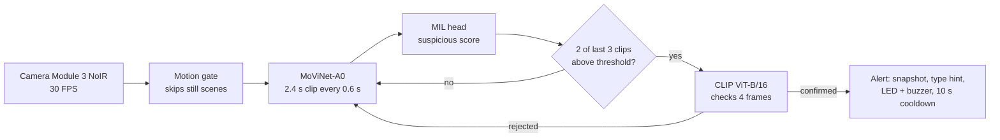
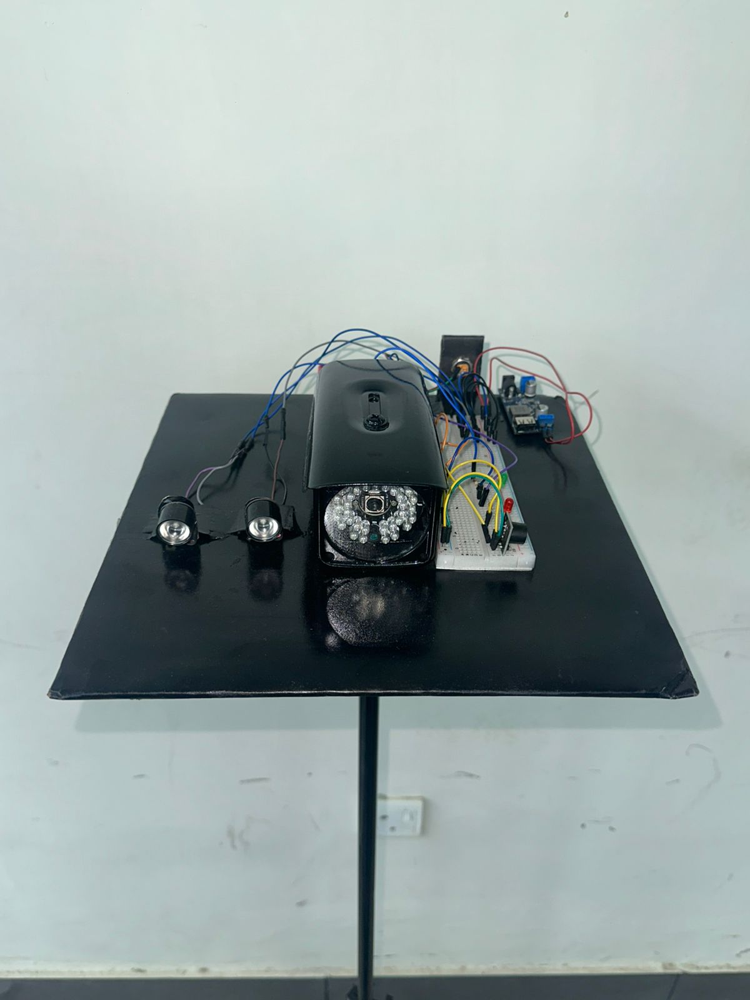
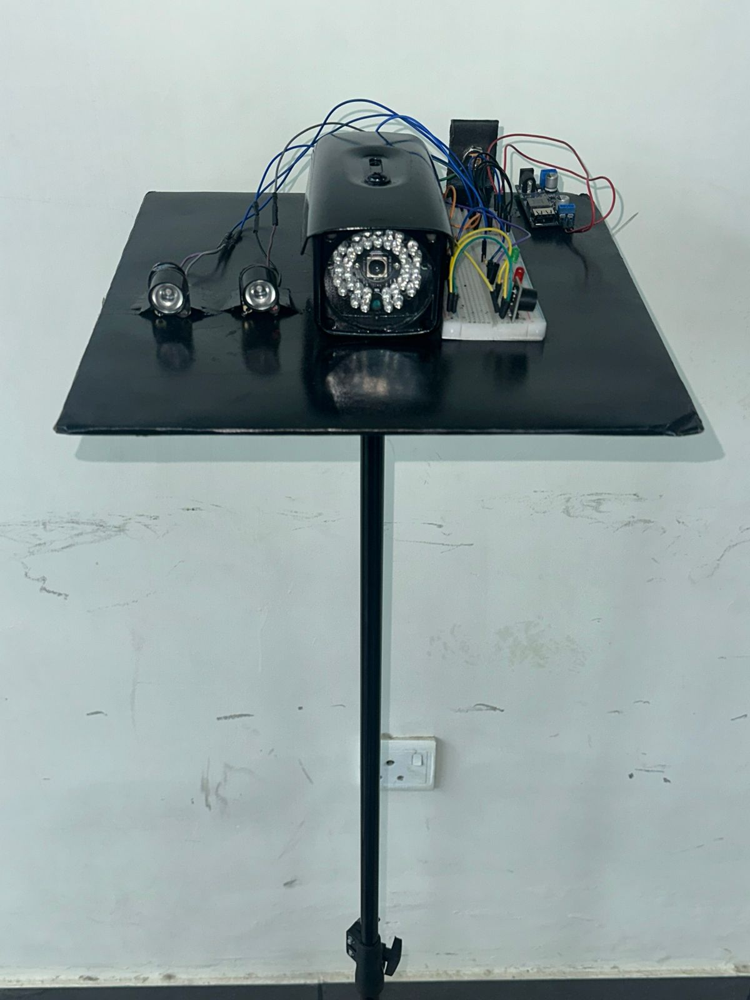
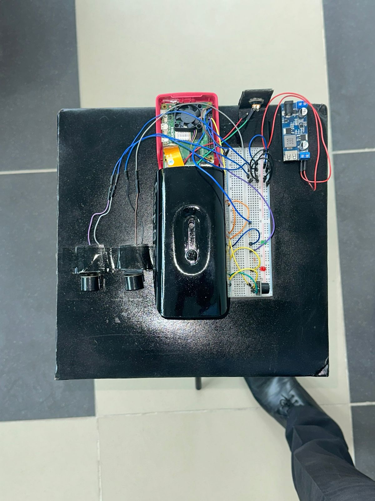
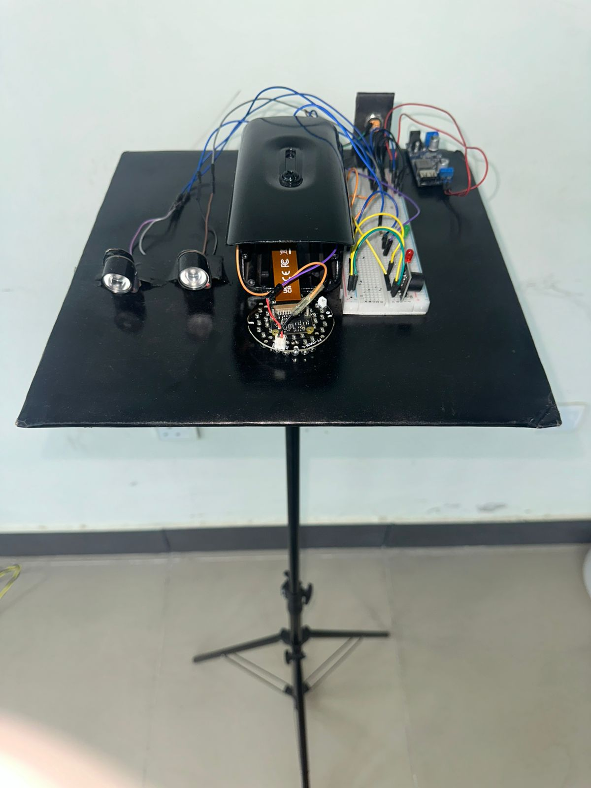
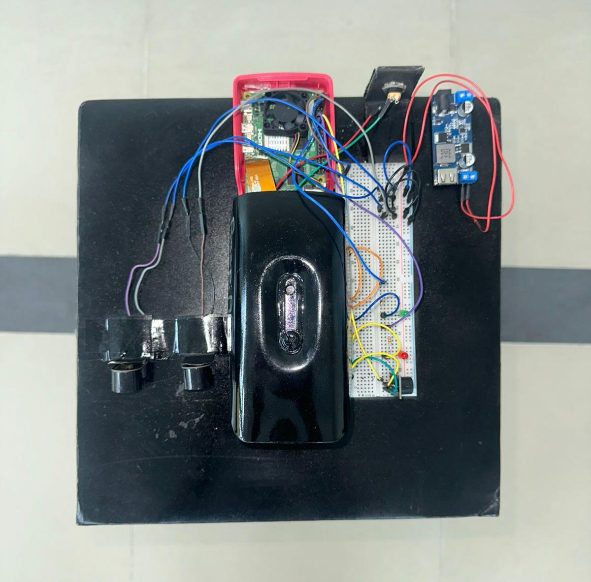
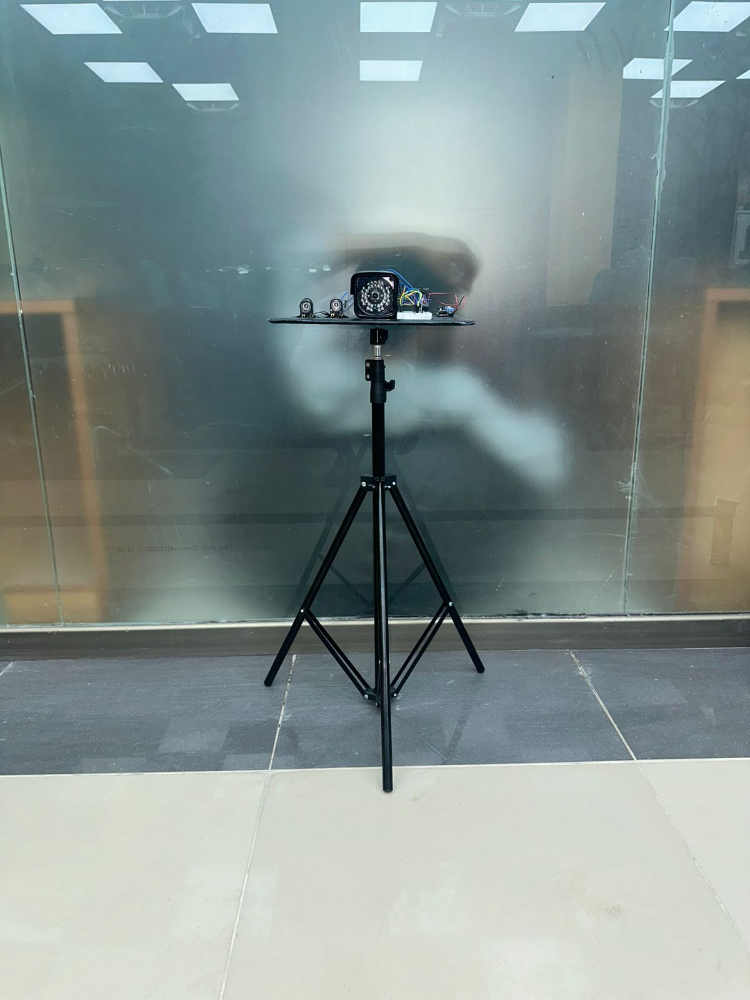

# PiLENS: Real-Time Crime and Violence Detection on a Raspberry Pi 5

PiLENS watches a live camera and raises an alert when it sees crime or violence (theft, robbery, fighting, vandalism and similar events). The whole AI pipeline runs on the CPU of a Raspberry Pi 5, with no GPU and no cloud, and the video stays on the device.

**Current version: [v3.0](v3/)** (MoViNet-A0 video model + CLIP alert check). Older versions stay in their own folders, so their code and results remain reproducible.

| Version | Folder | Main model | Status |
|---|---|---|---|
| **v3.0** | [`v3/`](v3/) | MoViNet-A0 (frozen, 3.1M parameters) + MIL head; CLIP ViT-B/16 confirms each alert | **Current** |
| v2.0 | [`v2/`](v2/) | X3D-S (frozen) + MIL head, two-stage cascade | Replaced by v3 |
| v1.0 | [`v1/`](v1/) | YOLO11n person detection + ResNet18-LSTM, face recognition, PyQt6 GUI | First prototype |

[CHANGELOG.md](CHANGELOG.md) lists what changed in each version, and [docs/RELEASING.md](docs/RELEASING.md) explains how a new version is added.

## How v3 works



1. A motion gate skips clips in which nothing moves.
2. MoViNet-A0 turns each 13-frame clip (about 2.4 s) into a feature, and a small head gives a suspicious score. A new clip is scored every 0.6 s.
3. An alert needs 2 of the last 3 clips above the threshold, and is followed by a 10 s cooldown.
4. Only when an alert is raised, CLIP ViT-B/16 looks at 4 frames of that clip and confirms or rejects it. A confirmed alert carries a crime-group hint (violence, theft, fire or damage, road accident).

## Key results (v3)

Every number below comes from a file in [`v3/results/`](v3/results/). Thresholds were chosen on validation data, and each test set was used once.

| What | Result |
|---|---|
| UCF-Crime, video AUC (5 seeds) | 0.919 ± 0.003 (X3D-S in v2: 0.889 ± 0.004) |
| UCF-Crime, frame AUC | 0.828 |
| XD-Violence (753-video single-label test subset), video AUC | 0.980 |
| CLIP alert check on the UCF-Crime test set (sensitive operating point) | false alerts on normal videos 16.4% → 3.6%; recall 83.6% → 80.3% |
| Pi 5 speed, MoViNet-A0, 3 threads | 137 ms per clip; 10-minute soak flat at 65–67 °C, no throttling |
| Pi 5 live, 2 hours, normal room, CLIP loaded | 216,036 frames at 30 FPS, 0 dropped, max 63.9 °C; 0 alerts at the deployed threshold (95% upper bound 1.5 false alerts per hour) |
| CLIP check on the Pi (fp32, 4 frames, 3 threads) | about 2.0 s, and it runs only on alerts |
| Crime type, 13 classes / 4 groups | 33–36% / 62.4% (chance 7.7% / 31.4%), used only as a hint |

Limits, stated plainly: night performance has been tested only on simulated IR video, not on real night recordings. The 2-hour live run was in a normal indoor room, so it shows that the system stays quiet, not how it behaves in a busy shop. The crime type is a hint, not a decision.

## Quick start (v3 on a Raspberry Pi 5)

```bash
git clone https://github.com/Huzzi-10/PiLENS-Real-Time-AI-Based-Suspicious-Activity-Detection-with-NightVision-on-Raspberry-Pi.git PiLENS
cd PiLENS/v3
python3 -m venv venv && source venv/bin/activate
pip install -r requirements-pi.txt
python pilens_demo.py --check      # 1-minute self-test
python pilens_demo.py              # live camera
```

The MoViNet-A0 model is included in [`v3/export_movinet/`](v3/export_movinet/). The CLIP check needs the `export_clip_b16/` folder (345 MB), which is too large for git; see [v3/README.md](v3/README.md#clip-model).

## Hardware

Raspberry Pi 5 (8 GB, 64-bit OS), Raspberry Pi Camera Module 3 NoIR, IR illuminator, fan and heatsink, official Raspberry Pi power supply, LED on GPIO 17 and buzzer on GPIO 18. Wiring: [docs/hardware/hardware_setup.md](docs/hardware/hardware_setup.md).

| Prototype | Prototype | Prototype |
| --- | --- | --- |
|  |  |  |
|  |  |  |

## Repository layout

```
v3/            current version: Pi runtime, model files, Kaggle training scripts, evaluation, results
v2/            X3D-S pipeline (pilens_v2 package, notebook, Pi scripts, tests)
v1/            first prototype (YOLO + CNN-LSTM programs, models, training notebook)
assets/        photos and diagrams
docs/          shared hardware notes and the release guide
CHANGELOG.md   what changed in each version
```

## Team

Developed by Huzaifa Asad at The Islamia University of Bahawalpur, supervised by Dr. Mobeen Shahroz. The backbone comparison experiments were run by Manaheel Hashim. PiLENS is the first product of [PiVisen AI](https://pivisen.com).

A research paper on PiLENS v3 is in preparation. Citation details will be added here once it is published.

## License

Apache License 2.0, see [LICENSE](LICENSE). The datasets (UCF-Crime, XD-Violence) and the pretrained weights (MoViNet, CLIP) keep their own licenses.
